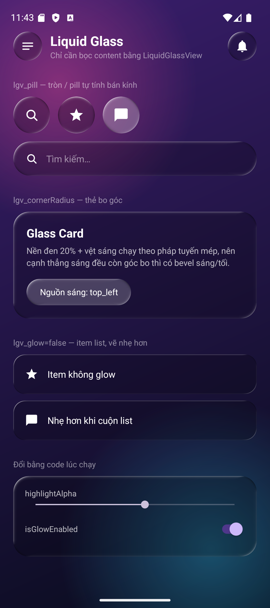
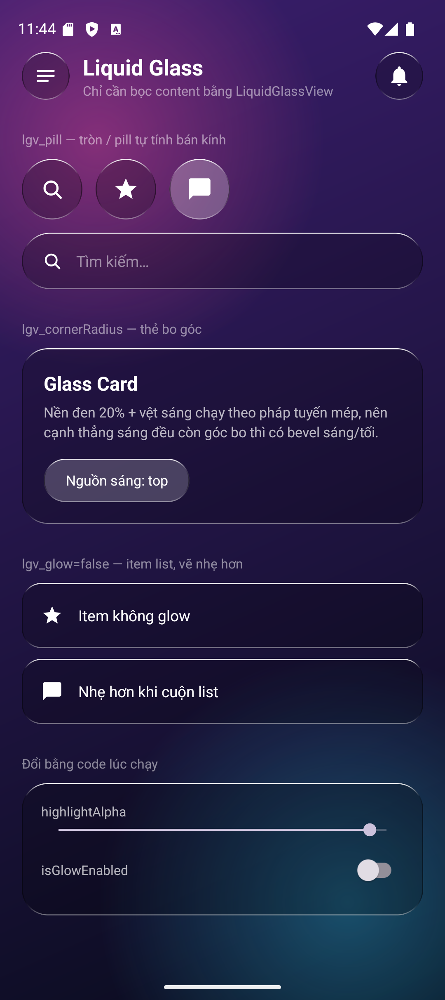

# Liquid UI – Android Library

**LiquidLayout** là một `FrameLayout` vẽ sẵn nền kính "Liquid Glass": nền mờ + vệt sáng chạy
theo mép (bevel sáng/tối như kính thật) + quầng sáng mềm. Bọc content vào là có ngay giao diện
liquid — không cần drawable, không cần `Activity`, dùng được cả trong item `RecyclerView`.

Library id: `vn.minh_nguyen.vkey.liquid.ui`

## Demo

Trái: mặc định. Phải: `highlightAlpha` cao + `lgv_glow=false` (chỉ còn viền nét).

<p align="center">
  
  
</p>

---

## Cài đặt (qua JitPack)

Thêm vào `settings.gradle.kts` (hoặc `build.gradle` project):

```
	dependencyResolutionManagement {
		repositoriesMode.set(RepositoriesMode.FAIL_ON_PROJECT_REPOS)
		repositories {
			google()
			mavenCentral()
			maven { url = uri("https://jitpack.io") }
		}
	}
```

Thêm dependency vào `build.gradle` (module):

```
	dependencies {
	        implementation("com.github.minh-nguyen-2003:Liquid-UI-Android:1.0.5")
	}
```

Nếu JitPack build ra dạng multi-module thì coordinate là
`com.github.minh-nguyen-2003.Liquid-UI-Android:liquid_ui:1.0.5` — xem log build trên JitPack để
lấy đúng dòng.

## Nhớ thay 1.0.5 bằng tag release mới nhé.

## Cách sử dụng cơ bản

Khai trong XML, content đặt bên trong như `FrameLayout` thường:

```xml
<vn.minh_nguyen.vkey.liquid.ui.LiquidLayout
    android:layout_width="44dp"
    android:layout_height="44dp"
    app:lgv_pill="true">

    <ImageView
        android:layout_width="match_parent"
        android:layout_height="match_parent"
        android:padding="11dp"
        android:src="@drawable/ic_menu" />
</vn.minh_nguyen.vkey.liquid.ui.LiquidLayout>
```

Không khai gì thêm thì mặc định đã ra kính: nền đen 20%, bo 12dp, vệt sáng trắng 1dp từ góc
trên-trái, có quầng sáng.

## Thuộc tính XML

| Attribute | Kiểu | Mặc định | Mô tả |
|-----------------------------|-----------|--------------------|-------------------------------------------------------------------------------------------------|
| `lgv_backgroundColor` | color | `#33000000` | Màu nền kính (đen 20%). |
| `lgv_cornerRadius` | dimension | `12dp` | Bán kính bo; tự clamp về nửa cạnh ngắn. Bị bỏ qua khi bật `lgv_pill`. |
| `lgv_pill` | boolean | `false` | `true`: bán kính = nửa cạnh ngắn ⇒ view vuông ra **hình tròn**, view ngang ra **pill**. |
| `lgv_highlightColor` | color | `#FFFFFFFF` | Màu vệt sáng. Vệt **tối** luôn là đen (bóng = thiếu sáng) nên không đổi theo attr này. |
| `lgv_highlightWidth` | dimension | `1dp` | Độ dày vệt sáng nét. |
| `lgv_highlightAlpha` | float | `0.55` | Alpha đỉnh của vệt sáng, tự clamp 0..1. Đặt `0` để tắt hẳn viền. |
| `lgv_highlightOrientation` | enum | `top_left_bottom_right` | Hướng nguồn sáng — xem bảng dưới. |
| `lgv_glow` | boolean | `true` | Quầng sáng mềm loang vào trong. Tắt cho item list cuộn nhiều. |
| `lgv_clipContent` | boolean | `true` | Bo góc luôn content bên trong (`clipToOutline`). |

## Enum `lgv_highlightOrientation`

Giá trị khớp hằng số trong `LiquidGlassOrientation` nên đổi bằng XML hay bằng code đều như nhau.

| Enum XML | Hằng số Kotlin | Nguồn sáng đặt ở |
|--------------------------|--------------------------------------------------|-------------------|
| `left_right` | `LiquidGlassOrientation.LEFT_RIGHT` | Cạnh trái |
| `top_bottom` | `LiquidGlassOrientation.TOP_BOTTOM` | Cạnh trên |
| `top_left_bottom_right` | `LiquidGlassOrientation.TOP_LEFT_BOTTOM_RIGHT` | Góc trên-trái (mặc định) |
| `top_right_bottom_left` | `LiquidGlassOrientation.TOP_RIGHT_BOTTOM_LEFT` | Góc trên-phải |

## API trong code

Mỗi attribute đều có một property tương ứng, set xong tự `invalidate()`:

| Property | Kiểu | Ghi chú |
|------------------------|---------|-------------------------------------------------------------------------|
| `glassColor` | `Int` | Không đặt tên `backgroundColor` vì trùng `View.setBackgroundColor`. |
| `cornerRadius` | `Float` | Đơn vị **px** (dùng `resources.getDimension(...)` để đổi từ dp). |
| `isPill` | `Boolean` | Bật thì `cornerRadius` bị bỏ qua. |
| `highlightColor` | `Int` | |
| `highlightWidth` | `Float` | px. |
| `highlightAlpha` | `Float` | Tự clamp 0..1. |
| `highlightOrientation` | `Int` | Nhận hằng số `LiquidGlassOrientation`. |
| `isGlowEnabled` | `Boolean` | |
| `isClipContent` | `Boolean` | |

```kotlin
  glassView.highlightAlpha = 0.8f
  glassView.highlightOrientation = LiquidGlassOrientation.TOP_BOTTOM
  glassView.isGlowEnabled = false
```

Hoặc đổi nhiều thứ trong một lần — tham số nào bỏ trống thì giữ nguyên giá trị hiện tại:

```kotlin
  glassView.applyGlass(
      cornerRadius = resources.getDimension(R.dimen.card_radius),
      highlightAlpha = 0.7f,
      glow = false
  )
```

Tạo hoàn toàn bằng code cũng được (dùng như `FrameLayout`):

```kotlin
  val glass = LiquidLayout(context).apply {
      isPill = true
      addView(icon)
  }
```

## Chọn view nào

"Liquid" = viền sáng / ánh trượt vẽ trên mặt kính. "Glass" = làm mờ thật nội dung phía sau (kể cả
video). Tên view có chữ nào thì có phần đó:

| View | Liquid (viền sáng) | Glass (làm mờ nền) | Bẻ cong ở mép |
|---------------------|:---:|:---:|:---:|
| `LiquidLayout` | có | không | không |
| `GlassLayout` | không | có | không |
| `GlassLensLayout` | không | có | có |
| `LiquidGlassLayout` | có | có | có |

`GlassLensLayout` kế thừa `GlassLayout`, `LiquidGlassLayout` kế thừa `GlassLensLayout`, nên phần
"Nền được lấy từ đâu" và "Chi phí" ở mục dưới áp dụng cho cả ba.

## GlassLayout / GlassLensLayout — kính thuần, không liquid

Chỉ cần lớp kính mờ (thanh điều khiển, nhãn, khung chữ nổi trên video) mà không muốn viền sáng:

```xml
<!-- Chỉ làm mờ -->
<vn.minh_nguyen.vkey.liquid.ui.GlassLayout
    android:layout_width="match_parent"
    android:layout_height="56dp"
    app:gl_cornerRadius="16dp" />

<!-- Làm mờ + bẻ cong nền ở mép như thấu kính -->
<vn.minh_nguyen.vkey.liquid.ui.GlassLensLayout
    android:layout_width="40dp"
    android:layout_height="40dp"
    app:gll_refraction="0.8" />
```

| Attribute | View | Kiểu | Mặc định | Mô tả |
|-------------------|--------------------|-----------|---------------|-------------------------------------------------------------------------|
| `gl_color` | cả hai | color | `#4D171717` | Màu phủ trên nền đã làm mờ, kèm độ mờ. |
| `gl_cornerRadius` | cả hai | dimension | bo tròn hai đầu | Bán kính bo; không khai thì tròn / pill. |
| `gl_blur` | cả hai | boolean | `true` | Làm mờ nền phía sau. Tắt thì chỉ còn lớp màu. |
| `gl_blurRadius` | cả hai | dimension | `4dp` | Độ mờ của nền: độ lệch chuẩn của mờ Gauss (như `blur()` của CSS), càng lớn càng nhoè. Dùng được cả trên `LiquidGlassLayout`. |
| `gl_backdrop` | cả hai | enum | `all` | `all`: làm mờ mọi thứ phía sau (giao diện + video). `media`: chỉ video và ảnh phủ màn, nhẹ hơn. |
| `gll_refraction` | `GlassLensLayout` | float | `0.8` | Độ bẻ cong nền ở mép; `0` = tắt. |

`GlassLayout` giữ nguyên màu và cỡ của nền (chỉ mờ đi). `GlassLensLayout` phóng nền 12 % quanh tâm
và đậm màu hơn 40 % cho ra cảm giác thấu kính. Property trong code: `glassColor`, `cornerRadius`,
`blurEnabled`, `refraction`.

## LiquidGlassLayout — kính có blur nền thật + khúc xạ

`LiquidLayout` ở trên không blur. Khi cần nút kính đầy đủ — **làm mờ thật nội dung phía sau**, bẻ
cong ở mép và có viền sáng liquid (kiểu iOS), ví dụ nút nổi trên trình phát video — dùng
`LiquidGlassLayout`:

```xml
<vn.minh_nguyen.vkey.liquid.ui.LiquidGlassLayout
    android:layout_width="40dp"
    android:layout_height="40dp">

    <ImageView
        android:layout_width="16dp"
        android:layout_height="16dp"
        android:layout_gravity="center"
        android:src="@drawable/ic_star" />
</vn.minh_nguyen.vkey.liquid.ui.LiquidGlassLayout>
```

Lớp kính gồm, từ dưới lên: nền phía sau đã làm mờ (đậm màu hơn 40 %, bị **bẻ cong ở mép** như
thấu kính) → nền màu → ánh trượt trên mặt kính → viền sáng theo hướng đèn. Mặc định bo tròn hai
đầu (view vuông ra hình tròn), content bên trong được cắt theo hình kính.

| Attribute | Kiểu | Mặc định | Mô tả |
|--------------------|-----------|---------------|-----------------------------------------------------------------------------------------|
| `lgl_color` | color | `#4D171717` | Màu nền kính kèm độ mờ. |
| `lgl_cornerRadius` | dimension | bo tròn hai đầu | Bán kính bo; không khai thì tròn / pill. |
| `lgl_rimWidth` | dimension | `1dp` | Độ dày viền sáng. |
| `lgl_rimColor` | color | trắng | Màu viền sáng và ánh trượt. |
| `lgl_rimAlpha` | float | `0.55` | Độ sáng lớn nhất của viền ở phía nguồn sáng. |
| `lgl_lightAngle` | float | `225` | Hướng nguồn sáng, độ: 0 = phải, tăng theo chiều kim đồng hồ (225 = trên trái). |
| `lgl_sheenAlpha` | float | `0.16` | Độ sáng ánh trượt trên mặt kính; `0` = tắt. |
| `lgl_pressScale` | float | `0.92` | Tỉ lệ lún khi giữ (chỉ khi view `clickable`); `1` = không lún. |
| `lgl_blur` | boolean | `true` | Làm mờ nền phía sau. Tắt thì chỉ còn nền màu + viền. |
| `lgl_refraction` | float | `0.8` | Độ bẻ cong nền ở mép: mép với tới vành nền ngoài nút bằng chừng này lần bán kính; `0` = tắt. |

Mỗi attribute có property tương ứng trong code: `glassColor`, `cornerRadius`, `rimWidth`,
`rimColor`, `rimAlpha`, `lightAngle`, `sheenAlpha`, `pressScale`, `blurEnabled`, `refraction`.

**Nền được lấy từ đâu.** View tự chụp phần nằm sau nó, không cần nối tay. Thuộc tính `gl_backdrop`
(dùng được cho cả `GlassLayout`, `GlassLensLayout`, `LiquidGlassLayout`; trong code là
`backdropMode`) chọn chụp gì:

- `all` (mặc định, giống kính iOS): **mọi thứ đang hiện** trong cửa sổ — danh sách, chữ, ảnh, nút —
  và cả video. Giao diện thường được vẽ lại vào ảnh nền; khung hình video đọc riêng rồi ghép đúng
  vị trí, đúng thứ tự trên / dưới. Các view kính không lẫn vào nền của nhau.
- `media`: chỉ video và `ImageView` phủ ít nhất nửa cửa sổ. Nhẹ hơn nhiều vì không vẽ lại cả cây
  view — hợp với nút nổi trên trình phát video khi cần chạy mượt trên máy yếu. Không có nguồn nào
  thì view chỉ còn lớp màu + viền.

Lưu ý chung:

- Video phải vẽ bằng `TextureView` — với Media3 / ExoPlayer đặt `app:surface_type="texture_view"`.
  `SurfaceView` **không** chụp lại được.
- Ảnh là bitmap phần cứng (Glide mặc định từ Android 8) không vẽ lại được vào ảnh nền, nhánh view
  chứa nó bị bỏ qua — tải ảnh với `.disallowHardwareConfig()`.
- Phép thu nhỏ / dịch chuyển / cuộn của nội dung phía sau (video đang pinch, trang đang vuốt) đều
  được tính.
- Có một view xin `all` là cả cửa sổ chụp ở chế độ `all`.

**View kính trong hộp thoại / popup.** Hộp thoại là cửa sổ riêng nên mặc định view chỉ thấy nội
dung của chính hộp thoại. Muốn làm mờ màn phía sau thì chỉ gốc nền:

```kotlin
  glass.backdropRoot = requireActivity().findViewById(android.R.id.content)
```

**Độ mờ.** Nền được làm mờ kiểu Gauss (ba lượt mờ hộp chồng nhau) nên mịn, không lộ ô vuông. Chỉnh
bằng `app:gl_blurRadius` / `blurRadius` trên từng view (mặc định 4dp; kính mờ đặc kiểu iOS khoảng
8–12dp; muốn thấy rõ nền bị bẻ cong thì để nhỏ).

**Chi phí.** Các view kính cùng gốc nền dùng chung một ảnh nền (`GlassBackdrop`) cỡ 1/4, và mỗi lượt
chụp **chỉ vẽ lại + làm mờ đúng phần nằm sau các view kính** — vài nút nhỏ thì rất nhẹ, kính phủ cả
màn mới tốn như chụp cả cửa sổ. Nền cập nhật theo từng khung hình (tối đa một lần mỗi 12 ms), chỉ
khi cửa sổ có lượt vẽ mới: màn hình đứng yên thì không chụp. View kính trong hộp thoại chỉ chụp lại
khi màn phía sau vẽ lại. Chế độ `all` vẽ lại nhánh view nằm trong các vùng đó nên nặng hơn `media`;
thấy giật trên máy yếu thì chuyển các view trên video sang `media`.

**Khúc xạ theo hình kính.** Phần bẻ cong ở mép tính theo đúng hình của view — tròn, pill hay chữ
nhật bo góc (`lgl_cornerRadius` nhỏ cũng được): nền bị kéo cong vuông góc với mép gần nhất, bốn
góc không bị bỏ trống.

## Đổi mặc định cho cả app

Khai lại resource **cùng tên** trong app là ghi đè được default của library (resource của app
luôn thắng resource của thư viện):

```xml
<!-- app/src/main/res/values/liquid_glass_overrides.xml -->
<resources>
    <color name="liquid_glass_background">#40000000</color>
    <color name="liquid_glass_highlight">#FFFFFFFF</color>
    <!-- Dự án dùng sdp thì trỏ thẳng sang sdp cho khớp scale màn hình -->
    <dimen name="liquid_glass_corner_radius">@dimen/_12sdp</dimen>
    <dimen name="liquid_glass_highlight_width">@dimen/_1sdp</dimen>
</resources>
```

## Lưu ý

- `LiquidLayout` **không blur nội dung phía sau**. Nó chỉ phủ một lớp màu mờ + vẽ vệt sáng bằng
  `Canvas`, nhờ vậy nhẹ và dùng được ở mọi nơi. Muốn blur backdrop thật trên video / ảnh thì dùng
  `LiquidGlassLayout` (mục trên); trên giao diện thường thì bọc một `BlurView`
  (`eightbitlab:blurview`) bên ngoài rồi để `LiquidLayout` bên trong nó.
- Quầng sáng loang **vào trong**, không phải `BlurMaskFilter` — vì mask filter không chạy trên
  canvas hardware-accelerated, muốn có phải bật software layer (rất tốn khi cuộn list).
- Vệt sáng **không tự đảo chiều theo RTL**.
- Kính chỉ "ra chất" khi phía sau có màu/ảnh. Đặt trên nền phẳng một màu thì gần như chỉ thấy
  cái viền.

## Ví dụ hoàn chỉnh

```xml
<!-- Thanh search dẹt: vẫn chỉ 1 attr lgv_pill, không cần biết trước chiều cao -->
<vn.minh_nguyen.vkey.liquid.ui.LiquidLayout
    android:layout_width="match_parent"
    android:layout_height="52dp"
    app:lgv_pill="true">

    <LinearLayout
        android:layout_width="match_parent"
        android:layout_height="match_parent"
        android:gravity="center_vertical"
        android:orientation="horizontal"
        android:paddingStart="18dp"
        android:paddingEnd="18dp">

        <ImageView
            android:layout_width="20dp"
            android:layout_height="20dp"
            android:src="@drawable/ic_search" />

        <TextView
            android:layout_width="wrap_content"
            android:layout_height="wrap_content"
            android:layout_marginStart="12dp"
            android:text="Tìm kiếm…"
            android:textColor="#80FFFFFF" />
    </LinearLayout>
</vn.minh_nguyen.vkey.liquid.ui.LiquidLayout>

<!-- Item trong list: tắt glow cho nhẹ -->
<vn.minh_nguyen.vkey.liquid.ui.LiquidLayout
    android:layout_width="match_parent"
    android:layout_height="60dp"
    app:lgv_cornerRadius="18dp"
    app:lgv_glow="false" />
```

## Cấu trúc project

| Module | Vai trò |
|--------------|-------------------------------------------------------------------------------|
| `liquid_ui` | Library — chỉ phụ thuộc `androidx.core:core-ktx`, `minSdk 21`. |
| `app` | App demo: pill / card / item list + 3 control chỉnh thuộc tính lúc chạy. |

Phần tính toán nằm trong `LiquidGlassGeometry` (thuần Kotlin, không import `android.*`) nên
test được thẳng trên JVM:

```bash
./gradlew :liquid_ui:testDebugUnitTest
```

## License

MIT — xem [LICENSE](LICENSE).
